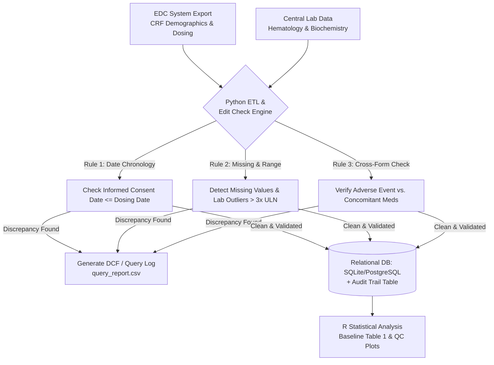

# Clinical Trial EDC Data Cleaning & Automated Edit Check Pipeline (ETL)

**臨床試験EDCデータクレンジング・自動論理チェック（Edit Check）検証パイプライン**

[English] | [日本語]

## Overview / 概要
This repository demonstrates an end-to-end **Clinical Data Management (CDM) ETL & Validation Pipeline** built with **Python, SQL (SQLite/PostgreSQL), and R**. Designed in alignment with **ICH-GCP (Good Clinical Practice)** data integrity principles, this pipeline integrates Electronic Data Capture (EDC) Case Report Forms (CRF) with external Central Laboratory data, executes automated clinical Edit Checks, maintains a full **Audit Trail**, and generates **Data Clarification Forms (DCF / Queries)** for site resolution.

本リポジトリは、**Python・SQL・R言語**を用いて構築した**臨床研究・治験におけるデータマネジメント（DM）用ETLおよび自動論理チェック検証パイプライン**のデモ実装です。ICH-GCPのデータインテグリティ基準に基づき、EDC（電子的データ収集システム）の症例報告書（CRF）データと外部臨床検査機関の検査データを統合し、論理矛盾や異常値の自動スクリーニング、監査証跡（Audit Trail）の記録、およびクエリ（DCF）の自動発行を行います。

---

## System Architecture / パイプライン処理フロー

---

## Key Clinical DM Features / 主な実装機能

1. **Multi-Source Data Extraction (Extract):**
   - Ingests raw subject CRF records (`edc_crf_raw.csv`) and central laboratory test logs (`central_lab_raw.csv`).
2. **Automated Clinical Edit Checks (Transform & Validate):**
   - **Chronological Logic Check:** Flags protocol deviations where the first study drug administration precedes the Informed Consent signature date (`ICF_DATE > DOSE_DATE`).
   - **Laboratory Safety Alert (Hy's Law / Toxicity Screening):** Automatically flags liver enzyme elevations (`ALT > 3 * ULN`) for medical review.
   - **Completeness Check:** Identifies missing critical baseline vitals or subject identifiers.
3. **Database Loading & GCP Audit Trail (Load):**
   - Loads validated datasets into a structured relational database (`clinical_dm.db`) with timestamped `audit_trail` logging every validation action.
4. **Biostatistics Handoff (R Integration):**
   - Provides `statistical_summary.R` to read locked/cleaned SQL tables and generate demographic summaries for Biostatisticians.

## System & Lab Hardware Simulation Floorplan / 医療機器・システム接続シミュレーション構成図

